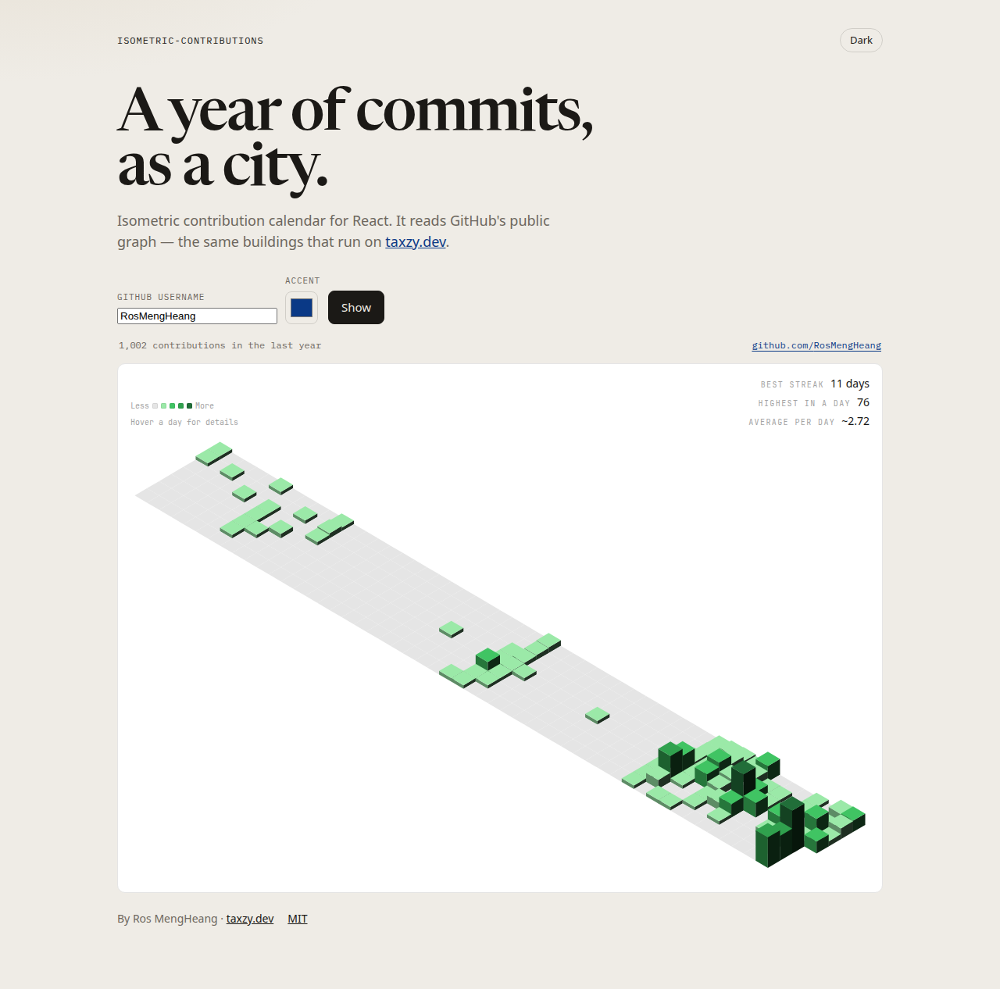
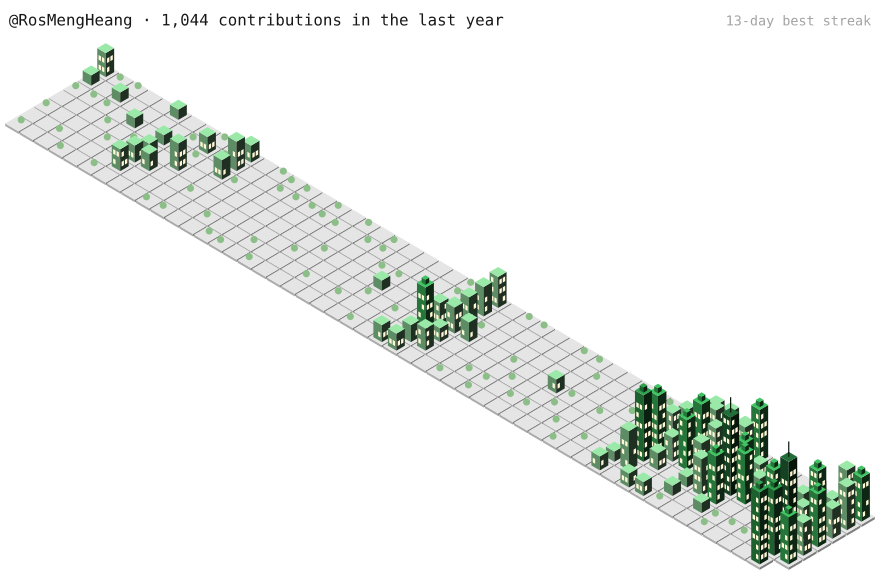
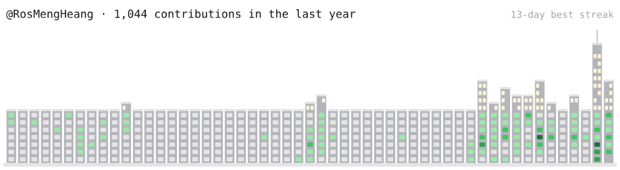

# isometric-contributions

Your GitHub contribution calendar, drawn as a city. Pick a style (3D blocks, a 3D city, a 2D skyline, or the classic grid) and a color theme. Then drop it into your portfolio as a React component, a static SVG, or a self-updating image in your GitHub profile README.

This is the calendar on [taxzy.dev](https://taxzy.dev). MIT licensed, by [Ros MengHeang](https://github.com/RosMengHeang) (Taxzy).



## Styles

| `variant` | Look |
| --- | --- |
| `isometric` (default) | 3D blocks. Height follows each day's count. |
| `city` | 3D skyscrapers on street plates, with lit windows, rooftop details, antennas on the busiest days, and trees on empty days. |
| `flat` | The classic 2D GitHub grid. |
| `skyline` | A 2D city. Each week is a tower whose height follows that week's total. Its bottom seven windows are the days. |

<p>
  
  
</p>

Themes: `github`, `halloween`, `ocean`, `sunset`, `neon`, `sakura`, `frost`, and `mono`. Each has a light and a dark ramp. You can also pass your own five colors.

## Pick the setup that fits your portfolio

| Your site | Use |
| --- | --- |
| Next.js, Remix, or any React app with a server | [React component](#react--nextjs) |
| Vite or another React SPA without a server | [React component + JSON at build time](#react-without-a-server) |
| Plain HTML, Astro, Vue, Svelte, Hugo, Jekyll, and so on | [Static SVG](#any-site-static-svg) |
| GitHub profile README | [GitHub Action](#github-profile-readme) |

Not sure which one? Run the demo (`npm run dev`), pick a style, and copy the snippet it generates for you.

## React / Next.js

```bash
npm install github:RosMengHeang/isometric-contributions
```

The package ships compiled JavaScript, type definitions, and CSS. It needs React 18 or newer and no extra bundler config: no `transpilePackages`.

```tsx
// app/github-city.tsx: a Server Component
import { IsometricContributions } from "isometric-contributions"
import { fetchContributionCalendar } from "isometric-contributions/contributions"

export async function GitHubCity() {
  const calendar = await fetchContributionCalendar("your-username", { next: { revalidate: 3600 } })
  return <IsometricContributions calendar={calendar} username="your-username" variant="city" theme="ocean" animate />
}
```

GitHub's contribution page does not send CORS headers, so fetch on the server and pass the result in as a prop. The component is marked `"use client"` because hover uses state. Import the fetcher from `isometric-contributions/contributions` so the request stays on the server.

The component imports its own stylesheet. If your bundler drops CSS from dependencies, import `isometric-contributions/styles.css` yourself.

### React without a server

Save the calendar as JSON at build time and import it:

```bash
npx github:RosMengHeang/isometric-contributions your-username --format json -o src/data/contributions.json
```

```tsx
import { IsometricContributions } from "isometric-contributions"
import calendar from "./data/contributions.json"

export const GitHubCity = () => <IsometricContributions calendar={calendar} variant="skyline" />
```

Add the command to a `prebuild` script so each deploy refreshes the data.

## Any site: static SVG

The CLI writes a standalone SVG. It needs no React, no CSS file, and no JavaScript on the page.

```bash
npx github:RosMengHeang/isometric-contributions your-username --variant city --theme neon -o public/github-city.svg
```

```html

```

By default the SVG follows the viewer's light or dark OS setting. Hovering a day in an inlined SVG shows its count as a tooltip.

```text
Usage: isometric-contributions <github-username> [options]

  -v, --variant <name>   isometric | city | flat | skyline   (default: isometric)
  -t, --theme <name>     github | halloween | ocean | sunset | neon | sakura | frost | mono
  -s, --scheme <name>    system | light | dark   (default: system)
      --colors <list>    five comma-separated colors, overrides --theme
  -f, --format <name>    svg | json   (default: svg)
  -o, --out <file>       write to a file instead of stdout
  -w, --width <px>       SVG width   (default: 880)
      --animate          buildings rise in when the image loads
      --background       fill the card color behind the drawing
      --no-header        hide the total / best-streak line
```

On a server you can render the same SVG yourself, for example in an Astro page or an API route:

```ts
import { fetchContributionCalendar } from "isometric-contributions/contributions"
import { renderContributionsSvg } from "isometric-contributions/svg"

const calendar = await fetchContributionCalendar("your-username")
const svg = renderContributionsSvg(calendar, { variant: "flat", theme: "sakura", username: "your-username" })
// Astro: <Fragment set:html={svg} />   API route: new Response(svg, { headers: { "content-type": "image/svg+xml" } })
```

## GitHub profile README

Add this workflow to your `<username>/<username>` repository. It redraws your city every day and publishes the SVG to an `output` branch.

```yaml
# .github/workflows/github-city.yml
name: GitHub city
on:
  schedule: [{ cron: "0 0 * * *" }]
  workflow_dispatch:
permissions:
  contents: write
jobs:
  render:
    runs-on: ubuntu-latest
    steps:
      - uses: RosMengHeang/isometric-contributions@main
        with:
          username: ${{ github.repository_owner }}
          variant: city
          theme: github
          output: dist/github-city.svg
      - uses: crazy-max/ghaction-github-pages@v4
        with:
          target_branch: output
          build_dir: dist
        env:
          GITHUB_TOKEN: ${{ secrets.GITHUB_TOKEN }}
```

Then add it to your README:

```md
/<username>/output/github-city.svg" alt="My GitHub city" />
```

The action takes the inputs `username`, `variant`, `theme`, `scheme`, `colors`, `output`, `width`, and `animate`. They match the CLI flags.

## Props

| Prop | Type | Default | |
| --- | --- | --- | --- |
| `calendar` | `ContributionCalendar \| null` | — | Parsed year. `null` renders the empty state. |
| `username` | `string` | `"octocat"` | GitHub login used in the empty-state link. |
| `variant` | `"isometric" \| "city" \| "flat" \| "skyline"` | `"isometric"` | Drawing style. |
| `theme` | `ThemeName` | `"github"` | Built-in color ramp. |
| `colors` | `[5 colors] \| { light?, dark? }` | — | Your own ramp, from no contributions to the most. Overrides `theme`. |
| `colorScheme` | `"auto" \| "system" \| "light" \| "dark"` | `"auto"` | `auto` follows a `dark` class on any ancestor. `system` follows the OS. |
| `animate` | `boolean` | `false` | Buildings rise in week by week. Skipped when the visitor prefers reduced motion. |
| `showStats` | `boolean` | `true` | Best streak, highest day, average per day. |
| `showLegend` | `boolean` | `true` | Legend and the hovered-day line. |
| `accentColor` | `string` | `"#0a3986"` | Highlight for the hovered day. Also settable with the CSS variable `--iso-accent`. |
| `className` | `string` | — | Extra class on the root element. |

```tsx
<IsometricContributions calendar={calendar} colors={["#eee", "#c7d2fe", "#818cf8", "#4f46e5", "#312e81"]} />
<IsometricContributions calendar={calendar} variant="flat" showStats={false} showLegend={false} />
```

Hover or tap a building to show that day under the legend. Building height is scaled to the busiest day of the year, and empty days stay flat.

## Dark mode

The light ramp is the default. Add the class `dark` to any ancestor (the hook Tailwind's class strategy uses), and the cells, legend, card, and text switch to the dark ramp. Or set `colorScheme="dark"` or `colorScheme="system"` on the component.

## API

```ts
import {
  IsometricContributions,      // React component
  fetchContributionCalendar,   // (username, init?) => Promise<ContributionCalendar | null>
  parseContributionCalendar,   // (html) => ContributionCalendar | null
  renderContributionsSvg,      // (calendar, options?) => string, also at "isometric-contributions/svg"
  buildScene,                  // framework-free geometry, if you want your own renderer
  summarizeCalendar,           // { total, best, highest, average, days }
  themes, themeNames, variants,
} from "isometric-contributions"
```

```ts
type ContributionDay = { date: string; count: number; level: number } // date YYYY-MM-DD, level 0–4
type ContributionCalendar = { total: number; weeks: (ContributionDay | null)[][] } // weeks[column][weekday]
```

`fetchContributionCalendar` accepts an optional `RequestInit` as its second argument (`{ cache: "no-store" }`, extra headers, and so on).

## How the HTML parse works

`fetchContributionCalendar(username)` requests:

```text
https://github.com/users/<username>/contributions
```

That URL is the public profile graph. The fetch sends no personal access token and does not call the GitHub REST API.

`parseContributionCalendar(html)` reads two things out of that fragment:

1. Each day is a `<td class="ContributionCalendar-day">` with `data-date`, `data-level` (`0`–`4`), and `id="contribution-day-component-{weekday}-{week}"`. Weekday `0` is Sunday. Cells GitHub does not render (future days in the current week) stay `null`.
2. The count is not on the cell. A sibling `<tool-tip for="that-id">` holds text such as `3 contributions on March 2nd.` or `No contributions on March 3rd.` Commas in large counts are ignored.

`calendar.total` is the sum of every parsed day. When the HTML has no cells, the parser returns `null`, and the component shows an empty state with a link to `https://github.com/<username>`. GitHub can change this markup. A failed parse becomes the empty state rather than a thrown error.

## Develop

```bash
git clone https://github.com/RosMengHeang/isometric-contributions.git
cd isometric-contributions
npm install        # also builds the library into dist/
npm run dev        # demo at http://localhost:5173, try /?user=octocat&variant=city&theme=neon
npm test
npm run build      # library into dist/, demo into demo-dist/
```

The demo site (`src/demo/`) has a live playground with style, theme, and option controls, a gallery of every style, SVG and PNG export, shareable links, and setup guides whose code follows your playground settings. The Vite dev and preview servers proxy `https://github.com/users/<username>/contributions` through `/api/github/<username>/contributions`, because browsers cannot read that page directly. On static hosting, the demo falls back to the public [github-contributions-api](https://github.com/grubersjoe/github-contributions-api), then to sample data.

## Credits

The contribution calendar on [taxzy.dev](https://taxzy.dev) is this component. It was extracted from Ros MengHeang's portfolio so it can be reused on its own.

## License

[MIT](LICENSE) © 2026 Ros MengHeang
